 

  

 

# ◈ BEYOND API INTEGRATION. INTO AI ENGINEERING.

**I build, optimize and deploy intelligent systems.**

I'm **Yash**, an AI/ML Engineer working across the layers of modern AI — from transformer-based language models and retrieval systems to autonomous agents and production infrastructure.

Currently building AI-powered products at **Oscrom Digital**, with hands-on experience in developing a 5M-parameter language model, production RAG applications, recommendation systems and AI-driven automation.

I enjoy understanding not just *how to use a model*, but **how the system behind it works** — its architecture, retrieval pipeline, inference behavior, memory constraints and deployment.

 

## 🔴 THE ENGINEERING FOCUS

<table>
<tr>
<td width="50%" valign="top">

**01 / MODEL ENGINEERING**

Transformer architectures, SLM development, model training, fine-tuning and LLM applications.

</td>
<td width="50%" valign="top">

**02 / INTELLIGENT SYSTEMS**

RAG architectures, AI agents, multi-step workflows, semantic retrieval and recommendation systems.

</td>
</tr>
<tr>
<td width="50%" valign="top">

**03 / AI INFRASTRUCTURE**

GPU architecture, CUDA, inference optimization, model serving and memory-efficient deployment.

</td>
<td width="50%" valign="top">

**04 / PRODUCTION ENGINEERING**

Python, FastAPI, Docker, AWS, backend systems and scalable AI services.

</td>
</tr>
</table>

 

## ⚡ PROOF OF WORK

- **5M-Parameter SLM** — Built an internal chatbot model using Sliding Window Attention.
- **Production Legal RAG** — Developed a Qwen-40B-powered legal search chatbot using BGE-M3 and vLLM.
- **25% Infrastructure Cost Reduction** — Optimized open-source model serving and GPU/RAM memory management.
- **SEO Indexing Platform** — Built a system capable of indexing and ranking URLs within 3–4 hours.
- **AI-Powered Recommendations** — Developed freelancer-to-project matching and automated milestone generation.
- **PII Detection** — Built solutions to identify sensitive information across text, images and uploaded files.

 

### BUILDING SYSTEMS. NOT JUST PROMPTS.

📍 Faridabad, Haryana, India · Open to AI/ML Engineering Opportunities

---

---

## 👨‍💻 About Me

### Building AI Systems. Engineering Intelligence.

I'm **Yash**, an AI/ML Engineer passionate about building intelligent systems that solve real-world problems.

Currently working at **Oscorm Digital Private Ltd.**, where I develop AI-powered applications, lightweight language models, recommendation systems and scalable backend solutions.

My experience spans the AI engineering lifecycle — from model development and experimentation to retrieval architecture, inference optimization and production deployment.

### 🔬 What I Work On

- 🧠 **LLM & SLM Engineering:** Developing lightweight language models, transformer architectures, model training and fine-tuning.
- 🏗️ **AI Architecture:** Designing scalable AI systems, model-serving pipelines and production-ready AI backends.
- 🤖 **Agentic AI:** Building intelligent agents and automated workflows using modern AI frameworks.
- 🔎 **RAG & Enterprise Search:** Developing document ingestion, embedding, hybrid retrieval and grounded question-answering systems.
- ⚡ **GPU & AI Infrastructure:** Exploring GPU architecture, CUDA, inference optimization and efficient model serving.
- ☁️ **Production AI:** Deploying and managing scalable AI services using Python, FastAPI, Docker and AWS.

### 💼 Professional Highlights

- Built a **5-million-parameter Small Language Model** using Sliding Window Attention for an internal chatbot.
- Developed a **production legal RAG chatbot** powered by Qwen-40B and BGE-M3.
- Reduced AI infrastructure costs by **25%** through optimized open-source model serving.
- Built an SEO indexing platform capable of indexing and ranking URLs within **3–4 hours**.
- Developed AI-powered recommendation, milestone generation and PII detection solutions.

 

**I enjoy working at the intersection of AI research, software engineering and scalable infrastructure.**

---

## 🛠️ Tech Stack & Technologies

### 💻 Programming & Backend

 

### 🧠 Machine Learning & Deep Learning

 

### 🤖 Generative AI & LLM Engineering

 

### 🗄️ Databases & Infrastructure

 

### 🔧 Development Tools

---

## ⚡ Featured Builds

### 🧠 5M Parameter Small Language Model (SLM)

Designed and developed a lightweight 5-million-parameter Small Language Model for an internal company chatbot, using Sliding Window Attention inspired by the architecture used in Mistral models.

`Python` `SLM` `Transformer Architecture` `Sliding Window Attention` `LLM Development`

---

### ⚖️ Production Legal Search Chatbot

Built a production-ready legal search chatbot powered by Qwen-40B and BGE-M3 embeddings using a Retrieval-Augmented Generation (RAG) architecture. Optimized model serving and hybrid GPU/RAM memory management, reducing infrastructure costs by 25%.

`Python` `Qwen-40B` `RAG` `BGE-M3` `vLLM` `pgvector` `FastAPI`

---

### 🔎 Scalable SEO Indexing Platform

Developed a scalable SEO indexing platform capable of indexing and ranking URLs within 3–4 hours, helping automate large-scale URL discovery and ranking workflows.

`Python` `Search Systems` `Indexing` `Ranking` `AWS`

---

### 🎯 AI-Powered Freelancer Recommendation System

Designed an intelligent recommendation system to match freelancers with relevant projects. Integrated AI-driven milestone generation and content enhancement to automate project planning and improve project descriptions.

`Python` `BGE-M3` `Embeddings` `Recommendation Systems` `MySQL`

---

### 🔐 Personal Information Detection (PII)

Developed AI-driven solutions to identify sensitive personal information across text, images, and uploaded files, helping improve data security and compliance.

`Python` `NLP` `Computer Vision` `PII Detection` `AI Security`

---

### 🎙️ DeepSpeech2-Based Speech-to-Text Model

Developed a DeepSpeech2-based speech recognition system with audio preprocessing, model training, and evaluation using Word Error Rate (WER) to measure transcription performance.

`Python` `TensorFlow` `Keras` `Deep Learning` `Speech Recognition` `WER`

---

### 🏥 Medi Chat-BOT — Disease Prediction Assistant

Built an interactive medical chatbot that collects user information such as name, age, and symptoms, and provides options for disease prediction and symptom checking using machine learning.

`Python` `Machine Learning` `NLP` `Healthcare AI` `Chatbot`

---

### 👁️ Face Recognition Attendance System

Developed a face recognition-based attendance system that compares real-time facial images against stored reference images to identify individuals.

`Python` `Computer Vision` `Face Recognition` `Deep Learning`

---

### 📊 Netflix Subscription Analysis

Performed exploratory data analysis on Netflix subscription data to understand customer subscription patterns and analyze regular versus other subscription behavior.

`Python` `Pandas` `NumPy` `Data Analysis` `Data Visualization`

## 🟡 Pac-Man Contribution Graph

<picture>
  <source media="(prefers-color-scheme: dark)"
    srcset="https://raw.githubusercontent.com/Yash0883/Yash0883/output/pacman-contribution-graph-dark.svg">
  <source media="(prefers-color-scheme: light)"
    srcset="https://raw.githubusercontent.com/Yash0883/Yash0883/output/pacman-contribution-graph.svg">
  
</picture>

---

## 🤝 Let's Connect

I'm interested in opportunities involving **AI Engineering, Machine Learning, LLM Development, Generative AI, and AI Infrastructure**.

**Thanks for visiting my profile! ⭐**

